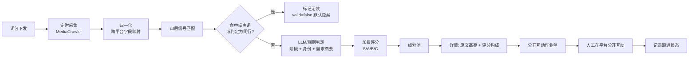

> 状态：已定稿 ｜ 最后更新：2026-10-20 ｜ 适用版本：原型 v0.1

# 01 · 需求规格

## 1. 背景

TO B / 高客单业务的获客难点不在"人多"，而在**判断谁真的要买**。
公开平台上的互动（评论、提问、求推荐）里混着大量噪声：同行打广告、个人用户闲逛、
纯情绪表达。销售如果逐条筛，成本极高；如果群发，既违平台规则也伤品牌。

本产品把"海量公开互动"压缩成"少量、可解释、可执行"的线索，并明确告诉使用者
**为什么这条值得跟、下一步在公开区怎么互动**。

## 2. 产品定位

**一句话：面向 TO B 高客单场景的意向雷达——按决策阶段与身份给公开互动分级，
产出可解释的线索与合规互动作业单。**

明确「不是」什么：

| 不是 | 原因 |
|---|---|
| 联系人爬取工具 | 数据源已脱敏，不存原始用户 ID / 主页 / 头像 / 联系方式 |
| 群发 / 私信工具 | 越界即违规，且违反上游许可 |
| 去匿名化工具 | 不提供任何反查真实身份的能力 |
| 通用舆情系统 | 只服务"要不要跟、怎么跟"，不做全网声量监控 |

## 3. 目标用户与角色

| 角色 | 关注点 | 主要操作 |
|---|---|---|
| 销售负责人 | 线索总量、质量、转化、渠道 ROI | 看概览与分析、调评分权重、分配线索 |
| 销售 | 今天该跟谁、怎么开口 | 看线索池与详情、改跟进状态、记录跟进 |
| 运营 | 词包是否有效、采集是否正常 | 维护四层信号词、配置采集任务 |
| 管理员 | 账号、预算、合规策略 | 设置 LLM、预算、采集参数、合规开关 |

> 原型阶段只有一个固定账号 `demo / demo123`，角色字段仅用于展示，未做权限隔离。

## 4. 目标与非目标

### 4.1 目标

1. **降噪**：把无效互动（同行广告、无关闲聊）过滤掉，默认不展示。
2. **分级**：用决策阶段 + 身份 + 意向强度给出 S/A/B/C 分级，排序即优先级。
3. **可解释**：每条线索都能看到命中了哪些词、在原文哪一句、各项得分怎么算的。
4. **可执行**：输出「去哪、做什么、切入角度、话术参考、注意事项」的公开互动作业单。
5. **可调**：评分权重、信号词、采集任务均可配置，且调整即时影响排序。

### 4.2 非目标

- 不做自动触达、自动私信、自动加好友。
- 不做用户画像还原、跨平台身份合并。
- 不做实时流式采集（当前为定时任务）。
- 不做移动端 App（原型仅桌面 Web）。

## 5. 术语表

| 术语 | 定义 |
|---|---|
| 线索（Lead） | 一条被判定为值得跟进的公开互动（通常是一条评论/提问） |
| 四层信号 | 噪声词、意向词、身份词、阶段词，用于过滤与判定 |
| 决策阶段 | 认知期 → 考察期 → 对比期 → 决策期，越靠后越接近成交 |
| 身份 | 企业主/决策人、经办人、影响者、个人用户、同行/服务商 |
| 有效线索 | 未被噪声词命中、且未被判定为同行的线索 |
| 作业单 | 公开互动的执行建议，不含用户标识与私信话术 |
| 权重 | 评分模型中各维度的重要性，可配置，内部自动归一化 |
| creator_hash | 上游对原始用户 ID 做的匿名哈希，仅用于同创作者内容归组 |

## 6. 核心业务流程



## 7. 功能需求

优先级：P0 = 原型必须可用；P1 = V1 必须；P2 = 后续。
状态：✅ 已实现（前端原型） / 🚧 规划中。

### 7.1 登录与访问控制

| ID | 需求 | 优先级 | 状态 |
|---|---|---|---|
| FR-101 | 未登录访问任意业务路由，跳转登录页并携带 `redirect` | P0 | ✅ |
| FR-102 | 登录成功后回跳原目标页 | P0 | ✅ |
| FR-103 | 已登录访问登录页，自动回首页 | P0 | ✅ |
| FR-104 | 登录态可持久化（记住登录），可主动退出 | P0 | ✅ |
| FR-105 | 固定演示账号 `demo / demo123`，错误密码给出明确提示 | P0 | ✅ |
| FR-106 | 服务端鉴权（JWT + 密码哈希），前端门禁不作为安全边界 | P1 | 🚧 |

> 前端路由守卫只防误入，不防绕过。V1 必须由后端逐请求校验。

### 7.2 概览

| ID | 需求 | 优先级 | 状态 |
|---|---|---|---|
| FR-201 | 展示今日新增、高价值（S/A）、待跟进、噪声过滤率 | P0 | ✅ |
| FR-202 | 今日线索播报：按"未跟进优先 + 分数降序"取前 6 条 | P0 | ✅ |
| FR-203 | 决策阶段漏斗：各阶段数量与平均分 | P0 | ✅ |
| FR-204 | 跟进状态看板：待跟进/已接触/已报价/已成交/已失效 | P0 | ✅ |
| FR-205 | 竞品提及次数（截流机会点） | P1 | ✅ |
| FR-206 | 需求主题分布（按来源关键词归集） | P1 | ✅ |

### 7.3 线索池

| ID | 需求 | 优先级 | 状态 |
|---|---|---|---|
| FR-301 | 列表默认只显示有效线索，可切换「全部」 | P0 | ✅ |
| FR-302 | 支持按平台、阶段、身份、状态、最低分、关键词筛选 | P0 | ✅ |
| FR-303 | 按实时评分降序排列 | P0 | ✅ |
| FR-304 | 分页 | P0 | ✅ |
| FR-305 | 评分权重变化后排序立即重排，无需刷新 | P0 | ✅ |
| FR-306 | 批量分配负责人、批量导出作业单（不含 PII） | P2 | 🚧 |

### 7.4 线索详情

| ID | 需求 | 优先级 | 状态 |
|---|---|---|---|
| FR-401 | 展示原帖信息、评论原文、来源关键词、时间、点赞数 | P0 | ✅ |
| FR-402 | 命中信号词在原文中高亮 | P0 | ✅ |
| FR-403 | 信号明细：词、层级、权重、命中片段 | P0 | ✅ |
| FR-404 | 评分构成：各项原始分、权重、加权贡献 | P0 | ✅ |
| FR-405 | 展示阶段、身份、需求摘要、竞品 | P0 | ✅ |
| FR-406 | 生成公开互动作业单（去哪/做什么/切入角度/话术/注意事项） | P0 | ✅ |
| FR-407 | 修改跟进状态并写入时间线 | P0 | ✅ |
| FR-408 | 添加跟进记录、分配负责人 | P1 | ✅ |
| FR-409 | 展示判定依据与置信度（模型输出可追溯） | P1 | 🚧 |

### 7.5 词包管理

| ID | 需求 | 优先级 | 状态 |
|---|---|---|---|
| FR-501 | 四层信号词分类展示与统计 | P0 | ✅ |
| FR-502 | 新增/编辑/启停信号词，设置权重与适用平台 | P1 | ✅ |
| FR-503 | 展示每个词的历史命中次数 | P1 | ✅ |
| FR-504 | 删除词时提示其对历史线索评分的影响 | P2 | 🚧 |

### 7.6 采集任务

| ID | 需求 | 优先级 | 状态 |
|---|---|---|---|
| FR-601 | 任务列表：词包、平台、调度、状态、抓取量、新增线索 | P0 | ✅ |
| FR-602 | 手动触发「立即运行」，状态 running → idle | P0 | ✅ |
| FR-603 | 启停任务 | P1 | ✅ |
| FR-604 | 真实调度与执行（APScheduler + MediaCrawler 子进程） | P1 | 🚧 |
| FR-605 | 任务失败重试与错误留痕 | P1 | 🚧 |

### 7.7 分析报表

| ID | 需求 | 优先级 | 状态 |
|---|---|---|---|
| FR-701 | 平台质量对比（数量、有效线索、平均分） | P1 | ✅ |
| FR-702 | 渠道 ROI（来源关键词 → 线索数 / 高价值 / 平均分 / 成交） | P1 | ✅ |
| FR-703 | 需求主题 TOP N | P1 | ✅ |
| FR-704 | 竞品声量排行 | P1 | ✅ |
| FR-705 | 时间维度趋势（按日/周） | P2 | 🚧 |

### 7.8 设置

| ID | 需求 | 优先级 | 状态 |
|---|---|---|---|
| FR-801 | 评分权重调节，右侧实时预览排名升降 | P0 | ✅ |
| FR-802 | 恢复默认权重 | P0 | ✅ |
| FR-803 | LLM 供应商、模型、温度、每日预算 | P1 | ✅（仅展示） |
| FR-804 | 采集参数：休眠、并发、单次最大笔记数、代理开关 | P1 | ✅（仅展示） |
| FR-805 | 合规策略：仅公开互动、禁止私信触达（默认开启且不建议关闭） | P0 | ✅ |
| FR-806 | 设置持久化到后端 | P1 | 🚧 |

## 8. 信号体系与评分模型

> 本节是评分规则的单一事实来源，其他文档只引用不重述。

### 8.1 四层信号

| 层级 | 作用 | 示例 |
|---|---|---|
| 噪声词 | 命中即判无效，默认不展示 | 招聘、代理、加V、刷单 |
| 意向词 | 表达购买/咨询倾向，决定意向强度 | 求推荐、多少钱、有供应商吗、想上一套 |
| 身份词 | 推断提问者身份 | 我们公司、我们厂、采购、老板、甲方 |
| 阶段词 | 推断决策所处阶段 | 了解一下、在对比、下个月上线、走合同 |

### 8.2 评分输入

评分由 6 个维度构成，每个维度先归一化到 0–100：

| 维度 | key | 来源 |
|---|---|---|
| 意向词强度 | `intent` | 命中意向词的加权强度 |
| 决策阶段 | `stage` | 阶段映射分 |
| 身份信号 | `identity` | 身份映射分 |
| 需求具体度 | `specificity` | 是否给出预算/规模/时间/场景等具体信息 |
| 时效性 | `freshness` | 互动时间距今越近分越高 |
| 互动热度 | `engagement` | 点赞/回复等公开互动量 |

阶段映射：认知期 30、考察期 60、对比期 85、决策期 100。
身份映射：企业主/决策人 100、经办人 85、影响者 60、个人用户 45、同行 0。

### 8.3 计算公式

```
score = Σ(weight_i × raw_i) / Σ(weight_i)
```

权重内部自动归一化，因此**权重之和不必等于 100**；全为 0 时按 1 处理避免除零。
结果四舍五入取整。

### 8.4 默认权重

| 维度 | 默认权重 |
|---|---|
| 意向词强度 `intent` | 30 |
| 决策阶段 `stage` | 25 |
| 身份信号 `identity` | 20 |
| 需求具体度 `specificity` | 10 |
| 时效性 `freshness` | 10 |
| 互动热度 `engagement` | 5 |
| **合计** | **100** |

### 8.5 分级

| 等级 | 分数区间 | 含义 |
|---|---|---|
| S | ≥ 85 | 高优先，当天跟进 |
| A | 70 – 84 | 优先跟进 |
| B | 50 – 69 | 常规跟进 |
| C | < 50 | 低优先或仅存档 |

### 8.6 无效线索

满足任一条件即 `valid = false`：命中噪声词，或被判定为同行/服务商。
无效线索评分强制为 0，默认从线索池隐藏，但保留在「全部」视图供审计。

### 8.7 可解释性要求

任何一条线索必须能回答三个问题，缺一不可：

1. **为什么是它**：命中了哪些词，落在原文哪一句（高亮 + 片段）。
2. **为什么这个分**：6 个维度的原始分、权重、加权贡献。
3. **下一步做什么**：作业单给出动作、角度、话术与注意事项。

## 9. 非功能需求

| 类别 | 要求 |
|---|---|
| 性能 | 线索列表 P95 < 800ms（1000 条量级）；首屏 < 2s |
| 可用性 | 单机部署可恢复；采集失败不影响已有线索浏览 |
| 一致性 | 权重变更后，列表排序与详情评分必须使用同一套权重 |
| 可观测 | 每个请求带 traceId；采集任务与 LLM 调用有结构化日志 |
| 安全 | 密码哈希存储；密钥只走环境变量；接口默认鉴权 |
| 合规 | 见 `08-合规与数据边界.md`，红线不可配置关闭 |
| 可维护 | 平台差异收敛在适配层，业务代码不出现平台分支 |
| 数据可靠性 | PostgreSQL 每日全量备份 + WAL 归档，故障可恢复到最近备份点 |

## 10. 验收标准

### 10.1 原型阶段（当前）

1. 未登录访问任意业务页被拦截，登录后回跳原页面。
2. 6 个业务页面均可渲染，无控制台错误。
3. 打开任意线索详情，能看到原文高亮、信号明细、评分构成、作业单。
4. 调整评分权重后，线索池排序随之改变。
5. 无效线索默认隐藏，切换「全部」后可见且分数为 0。
6. 子路径 `/radar` 在 dev 与构建产物下均可用（含无尾斜杠访问）。

### 10.2 V1 验收（真实数据）

1. 采集 → 入库 → 判定 → 展示全链路可跑通，数据可追溯到原始评论。
2. 阶段与身份判定的准确率有量化基线（人工标注 ≥ 200 条），并写入报告。
3. 同一批数据重复导入不产生重复线索（按平台 + comment_id 幂等）。
4. 所有接口需鉴权，未授权返回 401。
5. 响应体中不出现任何可识别个人身份的字段。

## 11. 分期计划

| 阶段 | 范围 | 出口条件 |
|---|---|---|
| MVP（已完成） | 前端原型 + Demo 数据 + 评分/作业单 | 演示脚本可完整走通 |
| V1 | FastAPI + PostgreSQL 15 + 真实采集入库 + LLM 判定 | 全链路跑通，准确率有基线 |
| V2 | 多用户与权限、批量分配、播报、趋势分析 | 可支撑小团队日常使用 |

## 12. 风险与依赖

| 风险 | 影响 | 缓解 |
|---|---|---|
| 上游许可禁止商业使用 | 无法直接商用 | 仅学习研究；商用需替换数据源或取得授权 |
| 脱敏后无法联系用户 | 只能公开互动，转化链更长 | 作业单聚焦公开区专业互动，人工执行 |
| LLM 判定不稳定 | 阶段/身份误判导致排序失真 | 规则 + 模型双通道，输出置信度，人工可纠正 |
| 平台反爬与限流 | 采集量不足 | 控制频率、代理、失败重试 |
| 评分权重被随意调整 | 排序不可比 | 权重变更留痕，提供恢复默认 |
