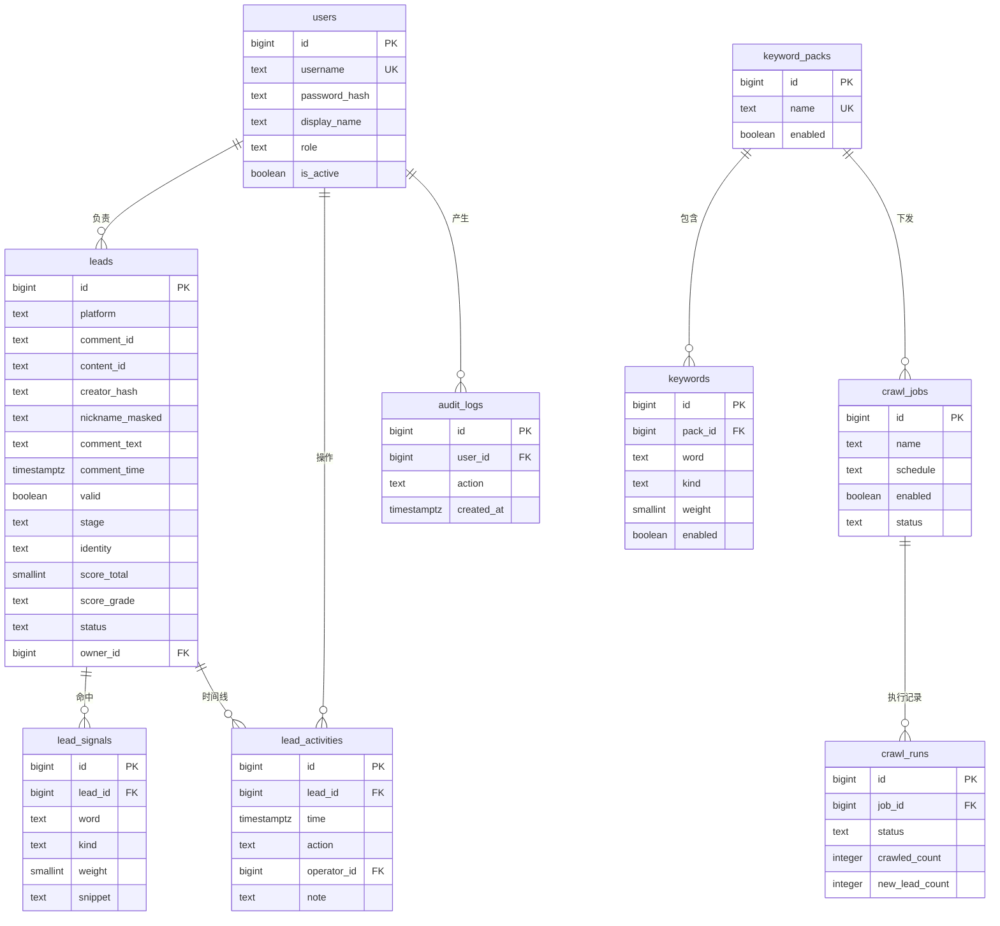

> 状态：草案 ｜ 最后更新：2026-10-20 ｜ 适用版本：后端规划

# 03 · 数据模型

## 1. 设计原则

1. **不复制原始身份数据。** 业务库只存归一化后的线索与信号，不存原始用户标识。
2. **幂等入库。** 以 `(platform, comment_id)` 唯一键保证重复采集不产生重复线索。
3. **评分物化。** `score_total` / `score_grade` 落库用于排序，权重变更时批量重算。
4. **判定可追溯。** 保存判定来源、置信度、prompt 版本，便于回溯与准确率评估。
5. **上游只读。** ClueRadar 不写 MediaCrawler 的库，适配层只读访问。

## 2. PostgreSQL 类型约定

| 场景 | 类型 | 说明 |
|---|---|---|
| 主键 | `BIGINT GENERATED ALWAYS AS IDENTITY` | 不用 `SERIAL`，避免序列权限问题 |
| 短文本 | `TEXT` | PG 中 `TEXT` 与 `VARCHAR(n)` 性能相同，不强行限长 |
| 数值枚举 | `TEXT` + `CHECK` | 不用 PG `ENUM`，加值需要改类型，迁移成本高 |
| 布尔 | `BOOLEAN` | 不用 0/1 |
| 计数 | `INTEGER` | 抓取量、点赞数 |
| 评分 | `SMALLINT` + `CHECK (0..100)` | 6 个维度与总分 |
| 结构数据 | `JSONB` | 竞品数组、平台数组、设置值 |
| 时间 | `TIMESTAMPTZ` | 库内存 UTC，API 输出带偏移的 ISO 8601 |
| 金额 | `NUMERIC(12,2)` | LLM 预算等 |

补充约定：

- 表名复数、字段名单数，全小写下划线。
- `created_at` / `updated_at` 默认 `now()`；`updated_at` 由 ORM `onupdate` 维护。
- 所有外键显式声明 `ON DELETE` 行为，不依赖默认值。
- 业务时间（评论发布时间）与系统时间（入库时间）分开存，不混用。

### 2.1 时间在 API 与前端之间的表示

| 层 | 表示 |
|---|---|
| 数据库 | `TIMESTAMPTZ`（内部 UTC） |
| Python | `datetime` 带 tzinfo |
| API | ISO 8601 带偏移：`2026-10-20T19:38:06+08:00` |
| 前端 | `new Date(iso)` 解析后按本地时区展示 |

> 原型阶段 mock 数据用的是无偏移的本地时间串（`2026-10-19T08:30:00`）。
> `new Date()` 对无偏移的日期时间按**本地时间**解析，因此两种格式都能被
> `fromNow()` 正确处理，前端不需要为接入后端改写展示逻辑。

## 3. 实体关系



## 4. 枚举字典

数据库存字符串并用 `CHECK` 约束，代码中使用同一组字面量，禁止存数字码。

| 枚举 | 取值 | 中文 |
|---|---|---|
| `platform` | `zhihu` `tieba` `bilibili` `xhs` `wb` `dy` `ks` | 知乎 / 贴吧 / B站 / 小红书 / 微博 / 抖音 / 快手 |
| `stage` | `awareness` `research` `comparison` `decision` | 认知期 / 考察期 / 对比期 / 决策期 |
| `identity` | `owner` `staff` `influencer` `individual` `peer` | 企业主决策人 / 经办人 / 影响者 / 个人用户 / 同行服务商 |
| `status` | `new` `contacted` `quoted` `won` `lost` | 待跟进 / 已接触 / 已报价 / 已成交 / 已失效 |
| `signal_kind` | `noise` `intent` `identity` `stage` | 噪声词 / 意向词 / 身份词 / 阶段词 |
| `grade` | `S` `A` `B` `C` | 分级 |
| `role` | `admin` `sales_manager` `sales` `ops` | 管理员 / 销售负责人 / 销售 / 运营 |
| `judge_source` | `rule` `llm` `hybrid` | 规则 / 模型 / 混合 |
| `judge_confidence` | `high` `medium` `low` | 高 / 中 / 低 |
| `job_status` | `idle` `running` `failed` | 空闲 / 运行中 / 失败 |
| `run_status` | `running` `success` `failed` | 运行中 / 成功 / 失败 |

## 5. 表定义

### 5.1 `users`

| 字段 | 类型 | 约束 | 说明 |
|---|---|---|---|
| `id` | BIGINT | PK IDENTITY | |
| `username` | TEXT | NOT NULL UNIQUE | 登录名 |
| `password_hash` | TEXT | NOT NULL | Argon2 或 bcrypt，禁止明文 |
| `display_name` | TEXT | NOT NULL | 展示名 |
| `role` | TEXT | NOT NULL DEFAULT 'sales' CHECK | 见枚举 |
| `is_active` | BOOLEAN | NOT NULL DEFAULT true | 停用而非删除 |
| `created_at` | TIMESTAMPTZ | NOT NULL DEFAULT now() | |
| `updated_at` | TIMESTAMPTZ | NOT NULL DEFAULT now() | |

### 5.2 `leads`

| 字段 | 类型 | 约束 | 说明 |
|---|---|---|---|
| `id` | BIGINT | PK IDENTITY | |
| `platform` | TEXT | NOT NULL CHECK | 枚举 |
| `comment_id` | TEXT | NOT NULL | 上游评论 ID |
| `content_id` | TEXT | NOT NULL | 作品/笔记/回答 ID |
| `creator_hash` | TEXT | NOT NULL | 上游匿名哈希，仅用于分组 |
| `nickname_masked` | TEXT | | 已掩码昵称，如「程***江」 |
| `content_title` | TEXT | | 原帖标题 |
| `content_url` | TEXT | | 原帖公开链接 |
| `source_keyword` | TEXT | NOT NULL DEFAULT '' | 来源关键词，用于渠道 ROI |
| `comment_text` | TEXT | NOT NULL | 评论原文（判定与高亮的依据） |
| `comment_time` | TIMESTAMPTZ | NOT NULL | 评论发布时间 |
| `like_count` | INTEGER | NOT NULL DEFAULT 0 CHECK (>= 0) | 点赞数 |
| `valid` | BOOLEAN | NOT NULL DEFAULT true | 是否有效 |
| `invalid_reason` | TEXT | | 无效原因 |
| `stage` | TEXT | NOT NULL CHECK | 枚举 |
| `identity` | TEXT | NOT NULL CHECK | 枚举 |
| `identity_note` | TEXT | | 身份判定补充说明 |
| `need_summary` | TEXT | | 一句话需求摘要 |
| `competitors` | JSONB | NOT NULL DEFAULT '[]' | 竞品名数组 |
| `intent_strength` | SMALLINT | NOT NULL CHECK (0..100) | 意向词强度 |
| `specificity` | SMALLINT | NOT NULL CHECK (0..100) | 需求具体度 |
| `freshness` | SMALLINT | NOT NULL CHECK (0..100) | 时效性 |
| `engagement` | SMALLINT | NOT NULL CHECK (0..100) | 互动热度 |
| `score_total` | SMALLINT | NOT NULL DEFAULT 0 CHECK (0..100) | 物化总分 |
| `score_grade` | TEXT | NOT NULL DEFAULT 'C' CHECK | 物化等级 |
| `judge_source` | TEXT | | rule / llm / hybrid |
| `judge_confidence` | TEXT | | high / medium / low |
| `prompt_version` | TEXT | | 判定所用提示词版本 |
| `status` | TEXT | NOT NULL DEFAULT 'new' CHECK | 枚举 |
| `owner_id` | BIGINT | FK `users(id)` ON DELETE SET NULL | 负责人，可空 |
| `created_at` | TIMESTAMPTZ | NOT NULL DEFAULT now() | 入库时间 |
| `updated_at` | TIMESTAMPTZ | NOT NULL DEFAULT now() | |

唯一约束：`UNIQUE(platform, comment_id)`。

### 5.3 `lead_signals`

| 字段 | 类型 | 约束 | 说明 |
|---|---|---|---|
| `id` | BIGINT | PK IDENTITY | |
| `lead_id` | BIGINT | NOT NULL FK `leads(id)` ON DELETE CASCADE | |
| `word` | TEXT | NOT NULL | 命中的词 |
| `kind` | TEXT | NOT NULL CHECK | 枚举 |
| `weight` | SMALLINT | NOT NULL CHECK (0..100) | 命中时该词的权重 |
| `snippet` | TEXT | | 命中所在原文片段 |
| `start_offset` | INTEGER | | 原文起始位置，可空 |
| `end_offset` | INTEGER | | 原文结束位置，可空 |

### 5.4 `lead_activities`

| 字段 | 类型 | 约束 | 说明 |
|---|---|---|---|
| `id` | BIGINT | PK IDENTITY | |
| `lead_id` | BIGINT | NOT NULL FK ON DELETE CASCADE | |
| `time` | TIMESTAMPTZ | NOT NULL DEFAULT now() | |
| `action` | TEXT | NOT NULL | 状态变更 / 添加跟进 / 分配负责人 |
| `operator_id` | BIGINT | FK `users(id)` ON DELETE SET NULL | 可空（系统动作） |
| `note` | TEXT | | 详情 |

### 5.5 `keyword_packs`

| 字段 | 类型 | 约束 |
|---|---|---|
| `id` | BIGINT | PK IDENTITY |
| `name` | TEXT | NOT NULL UNIQUE |
| `description` | TEXT | |
| `enabled` | BOOLEAN | NOT NULL DEFAULT true |
| `created_at` / `updated_at` | TIMESTAMPTZ | NOT NULL DEFAULT now() |

### 5.6 `keywords`

| 字段 | 类型 | 约束 | 说明 |
|---|---|---|---|
| `id` | BIGINT | PK IDENTITY | |
| `pack_id` | BIGINT | NOT NULL FK `keyword_packs(id)` ON DELETE CASCADE | |
| `word` | TEXT | NOT NULL | |
| `kind` | TEXT | NOT NULL CHECK | 四层信号 |
| `weight` | SMALLINT | NOT NULL DEFAULT 50 CHECK (0..100) | |
| `platforms` | JSONB | NOT NULL DEFAULT '[]' | 空数组表示全平台 |
| `enabled` | BOOLEAN | NOT NULL DEFAULT true | |
| `hit_count` | INTEGER | NOT NULL DEFAULT 0 CHECK (>= 0) | 历史命中数 |
| `created_at` / `updated_at` | TIMESTAMPTZ | NOT NULL DEFAULT now() | |

唯一约束：`UNIQUE(pack_id, word)`。

### 5.7 `crawl_jobs`

| 字段 | 类型 | 约束 | 说明 |
|---|---|---|---|
| `id` | BIGINT | PK IDENTITY | |
| `name` | TEXT | NOT NULL | |
| `pack_ids` | JSONB | NOT NULL DEFAULT '[]' | 词包 ID 数组 |
| `platforms` | JSONB | NOT NULL DEFAULT '[]' | 平台数组 |
| `schedule` | TEXT | NOT NULL | cron 表达式 |
| `enabled` | BOOLEAN | NOT NULL DEFAULT true | |
| `status` | TEXT | NOT NULL DEFAULT 'idle' CHECK | 枚举 |
| `last_run_at` | TIMESTAMPTZ | | |
| `crawled_count` | INTEGER | NOT NULL DEFAULT 0 | 累计抓取 |
| `new_lead_count` | INTEGER | NOT NULL DEFAULT 0 | 累计新增线索 |
| `created_at` / `updated_at` | TIMESTAMPTZ | NOT NULL DEFAULT now() | |

### 5.8 `crawl_runs`

| 字段 | 类型 | 约束 |
|---|---|---|
| `id` | BIGINT | PK IDENTITY |
| `job_id` | BIGINT | NOT NULL FK `crawl_jobs(id)` ON DELETE CASCADE |
| `started_at` | TIMESTAMPTZ | NOT NULL DEFAULT now() |
| `finished_at` | TIMESTAMPTZ | |
| `status` | TEXT | NOT NULL DEFAULT 'running' CHECK |
| `crawled_count` | INTEGER | NOT NULL DEFAULT 0 |
| `new_lead_count` | INTEGER | NOT NULL DEFAULT 0 |
| `error` | TEXT | |

### 5.9 `system_settings`

键值表，`value` 用 `JSONB`，便于直接按 JSON 路径查询。

| 字段 | 类型 | 约束 |
|---|---|---|
| `key` | TEXT | PK |
| `value` | JSONB | NOT NULL |
| `updated_at` | TIMESTAMPTZ | NOT NULL DEFAULT now() |

约定 key：`scoring.weights`、`llm.provider`、`llm.model`、`llm.temperature`、
`llm.daily_budget`、`crawler.max_sleep_sec`、`crawler.max_concurrency`、
`crawler.max_notes`、`crawler.enable_proxy`、`compliance.public_interaction_only`。

### 5.10 `audit_logs`

| 字段 | 类型 | 约束 | 说明 |
|---|---|---|---|
| `id` | BIGINT | PK IDENTITY | |
| `user_id` | BIGINT | FK `users(id)` ON DELETE SET NULL | 可空 |
| `action` | TEXT | NOT NULL | 如 `lead.status.update` |
| `target_type` | TEXT | | lead / keyword / setting |
| `target_id` | TEXT | | |
| `detail` | JSONB | | 变更前后值 |
| `ip` | INET | | PostgreSQL 原生 IP 类型 |
| `created_at` | TIMESTAMPTZ | NOT NULL DEFAULT now() | |

## 6. 索引设计

```sql
-- 幂等键
CREATE UNIQUE INDEX uq_leads_platform_comment ON leads (platform, comment_id);

-- 线索池默认排序：只索引有效线索（部分索引）
CREATE INDEX ix_leads_valid_score ON leads (score_total DESC) WHERE valid;

-- 平台筛选 + 时效排序
CREATE INDEX ix_leads_platform_time ON leads (platform, comment_time DESC);

-- 状态看板
CREATE INDEX ix_leads_status ON leads (status);

-- 我的线索
CREATE INDEX ix_leads_owner_status ON leads (owner_id, status);

-- 详情与信号匹配
CREATE INDEX ix_lead_signals_lead ON lead_signals (lead_id);
CREATE INDEX ix_keywords_kind_enabled ON keywords (kind) WHERE enabled;

-- 审计
CREATE INDEX ix_audit_logs_created ON audit_logs (created_at DESC);
CREATE INDEX ix_audit_logs_user ON audit_logs (user_id);
```

可选（数据量 > 1 万条再启用）：

```sql
CREATE EXTENSION IF NOT EXISTS pg_trgm;
CREATE INDEX ix_leads_comment_trgm ON leads USING gin (comment_text gin_trgm_ops);
CREATE INDEX ix_leads_summary_trgm ON leads USING gin (need_summary gin_trgm_ops);
```

> 关键词筛选目前用 `ILIKE '%kw%'`。数据量小的时候可接受；
> 超过 1 万条必须上 `pg_trgm` 索引，否则全表扫描。

## 7. 与 MediaCrawler 上游表的映射

上游按平台分表，且**字段命名不统一**。适配层必须逐平台处理，业务代码不得感知差异。
上游库是 MediaCrawler 的 SQLite 文件（`../MediaCrawler/database/sqlite_tables.db`），
ClueRadar **只读**，不写入、不修改，也不在本仓库维护上游表结构。

### 7.1 评论表

| 平台 | 评论表 | 内容 ID 字段 |
|---|---|---|
| 抖音 | `douyin_aweme_comment` | `aweme_id` |
| 知乎 | `zhihu_comment` | `content_id` |
| B站 | `bilibili_video_comment` | `video_id` |
| 微博 | `weibo_note_comment` | `note_id` |
| 贴吧 | `tieba_comment` | `note_id` |
| 快手 | `kuaishou_video_comment` | `video_id` |
| 小红书 | `xhs_note_comment` | `note_id` |

### 7.2 字段归一化

| ClueRadar | 上游字段 | 注意 |
|---|---|---|
| `platform` | 由表名推导 | |
| `comment_id` | `comment_id` | 平台内唯一 |
| `content_id` | 见上表 | 各平台字段名不同 |
| `comment_text` | `content`（多数）/ `content_text`（知乎内容表） | 知乎评论也是 `content` |
| `comment_time` | `create_time`（epoch 秒）/ `publish_time`（知乎，字符串） | 需转成带时区的 `datetime` |
| `like_count` | `like_count` | 部分表为 TEXT，需安全转 int |
| `creator_hash` | `creator_hash` | 直接使用，不解哈希 |
| `nickname_masked` | `nickname` / `user_nickname`（知乎） | 已是掩码值 |
| `source_keyword` | **评论表没有**，需从内容表取 | 见 7.3 |
| `content_title` | 内容表 `title` / `desc` | |
| `content_url` | 内容表 `aweme_url` / `video_url` / `note_url` | |

### 7.3 来源关键词的取法

`source_keyword` 只存在于内容表（作品/笔记/视频/回答），评论表没有。
适配层按 `content_id` join 对应内容表获取；join 不到时回退为任务上下文里的关键词，
再不行置空串，**不允许**用"未分类"污染统计口径（展示层可显示"未分类"，但库里存空串）。

### 7.4 幂等与去重

- 唯一键 `(platform, comment_id)`，入库用
  `INSERT ... ON CONFLICT (platform, comment_id) DO UPDATE`。
- 允许更新的字段：`like_count`、`comment_text`（编辑）、`score_*`（重算）。
- **不允许**覆盖：`status`、`owner_id`、`lead_activities`（人工数据优先）。

## 8. 脱敏约束

来自上游的脱敏策略，ClueRadar **继承且不得放宽**：

| 上游机制 | 说明 | ClueRadar 约束 |
|---|---|---|
| `creator_hash` | 原始用户 ID 经 sha256 后取前 16 位 | 只存哈希，不存原值，不做反查 |
| `mask_nickname` | 昵称中间字符替换为 `***` | 只存掩码值 |
| 已移除创作者档案表 | 无头像/签名/主页/性别/IP 归属地 | 不新增这些字段 |

禁止在 `leads` 或任何表中新增：原始用户 ID、手机号、邮箱、微信号、主页链接、
头像 URL、IP 归属地（`audit_logs.ip` 仅记录操作者请求来源，非被采集用户）、设备标识。

## 9. 保留策略

| 数据 | 保留 | 到期动作 |
|---|---|---|
| `leads` / `lead_signals` / `lead_activities` | 业务存续期 | 清理 12 个月无跟进的失效线索 |
| `audit_logs` | 180 天 | 按月分区，`DROP PARTITION` 或批量删除 |
| `crawl_runs` | 90 天 | 批量删除 |
| 上游原始库 | 建议 90 天 | 由 MediaCrawler 侧清理 |

清理任务放在 APScheduler 每日低峰执行，单批删除不超过 5000 行，避免长事务。

## 10. 迁移策略

- 全部 DDL 通过 Alembic，迁移文件按 `YYYYMMDD_描述.py` 命名。
- PostgreSQL 的 DDL 是事务性的：迁移失败自动回滚，不会留下半成品表。
- 每个迁移必须同时提供 `upgrade()` 与 `downgrade()`。
- 破坏性变更（删列/改类型）分两步：先加新列并双写，下个版本再删旧列。
- CI 必须在空库上执行 `alembic upgrade head`，再执行 `alembic downgrade base`。
- 禁止在应用启动时 `create_all()` 修改已存在表。
